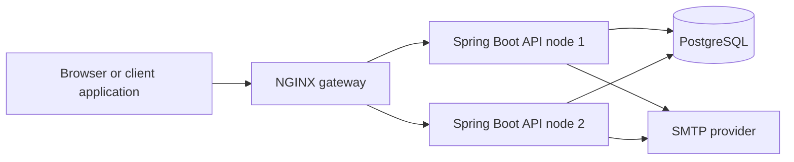

# Architecture and concurrency

## Request path

React assets are served by Spring Boot. NGINX distributes requests over the API containers. PostgreSQL stores the directory, roles, application registrations, browser sessions, consents, grants, audit events, and reset tokens. The same database also holds the encrypted signing key and request counters.

## Protocol layer

Spring Security Authorization Server supplies the OAuth 2.0/OIDC endpoints. `ClientStore` wraps its JDBC registered-client repository with application enablement. The standard JDBC authorization and consent services persist protocol state.

Public clients use authorization code + PKCE. Confidential browser/server clients use code + PKCE and can receive rotating refresh tokens. The service-client option uses client credentials with `api.read`. Redirect URLs must be exact HTTPS URLs, with HTTP permitted for explicit localhost loopback addresses during development.

The included OIDC SDK demo is served at `/demo`, with `/demo/callback` as its registered callback.

## Shared sessions

Spring Session JDBC stores authenticated sessions in PostgreSQL. A session is therefore available to either API node. A Spring Session-backed session registry also supports OIDC session handling.

The browser cookie is HTTP-only with SameSite=Lax. `COOKIE_SECURE=true` enables its secure flag for HTTPS deployment. CSRF tokens protect login and management mutations. Bearer-token resource requests use a separate stateless filter chain.

The account guard compares the session's account version to the directory record. Password resets, user access changes, and full access revocation increment that version and remove sessions/grants. Session lists expose a management ID separate from the browser's actual session ID.

## Concurrent changes

- Admin mutations lock a single directory-control row in a transaction. This protects the final enabled administrator and coordinates role/client mutations across nodes.
- User edits require the version read by the editor. Stale edits return HTTP 409.
- Authorization-code and refresh-token exchanges use a transaction-scoped PostgreSQL advisory lock derived from a hash of the submitted token. A second concurrent request sees the committed redemption result. Raw token values are absent from lock keys and logs.
- Reset links are hashed in the database. Reset consumption locks the target user before deleting the one-use token, so concurrent reset attempts cannot both replace the password.
- Signing-key creation uses the same database lock during startup. All nodes load the same key.
- Rate-limit increments use an atomic PostgreSQL upsert, keeping counters consistent across nodes.

Virtual request threads are enabled. Database pools remain bounded. Concurrent service capacity still depends on CPU for password hashing, available database connections, database latency, and integration request patterns.

## Authentication and authorization

Public registration creates an unverified, non-administrator account with no application roles. A hashed one-use verification token and the chosen account password complete verification. Signup cannot assign administrator privileges. A persistent bootstrap marker limits environment-based administrator initialization to initial setup.

`administrator` controls access to the management console. Application roles are separate records assigned to users. They are emitted as a `roles` array when the client requests and receives the `roles` scope.

Access-token audiences include the client ID and `gatehouse-api`. ID-token audiences identify the OIDC client. User subjects use stable account UUIDs.

The sample read API requires `api.read`. The sample editor API requires `api.write` and the `editor` role. Application clients still need to enforce their own resource-specific permissions.

## Keys and passwords

The directory and confidential-client passwords use Spring's delegating password encoder with bcrypt. Passwords must have at least 12 characters and fit within bcrypt's 72-byte UTF-8 input limit.

An RSA-3072 signing key is generated once and stored as an AES-256-GCM-encrypted JWK. `KEY_ENCRYPTION_SECRET` supplies its separate 32-byte encryption key. The public JWKS endpoint exposes public key material. Preserve the original master secret with database backups.

The current version retains one signing key. Automated key rotation and rollover are future extensions.

## Revocation

Disabling a user, changing roles, resetting passwords, and full access revocation remove that user's OAuth grants. Disabling an application or rotating its secret removes the application's grants. The sample API checks persistent grant state, so these revocations affect it on subsequent requests.

A signed JWT already held by another application can pass local signature validation until its five-minute lifetime ends. Introspection provides an online check for integrations requiring immediate revocation. Revoking one browser session ends that SSO session. Use the full user-access action to revoke all associated grants as well.

## Data model

- `iam_users`, `iam_roles`, and `iam_user_roles` hold directory data.
- `oauth2_registered_client`, `iam_client_status`, and `oauth2_authorization_consent` hold application configuration and consent.
- `oauth2_authorization` holds grants and token state.
- `spring_session` and `spring_session_attributes` hold shared browser sessions.
- `iam_signing_keys`, `iam_reset_tokens`, `iam_verification_tokens`, `iam_bootstrap`, and `iam_rate_limits` hold shared authentication state.
- `iam_audit` holds authentication and administrative events.

Flyway initializes and versions the schema. The OAuth/session tables are adapted from the official Spring Security 7.1.2 and Spring Session 4.1.1 schemas for PostgreSQL.
